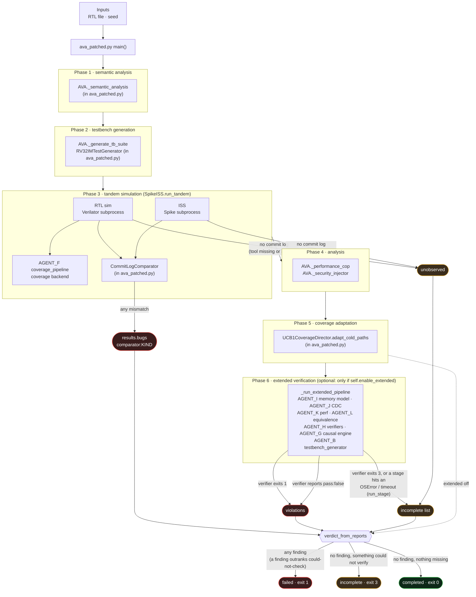

# The path of a run

Where a run's inputs go and where its exit code comes from. Boxes are placed by
their call site in `ava_patched.py`, not by the agent directory names: the
orchestrator runs phases 1 to 5 with classes defined in its own file, and imports
AGENT_B, F, G, H, I, J, K and L. It does not import AGENT_A, C, D or E, which are
standalone CLIs. Its `CommitLogComparator` is its own copy of AGENT_D's.

- **`failed` / 1** comes from two places only: a comparator finding in
  `results.bugs`, or a verifier that exits 1 or reports `pass: false`.
- **A missing tool becomes `incomplete` / 3** in two ways. A simulator that
  produced no commit log is recorded as `unobserved` (#138), because nothing was
  compared. A stage that raises an environment error is recorded by `run_stage`
  (#10). Both feed the same list, and an empty list is the only way to `completed`.
- The exit code is the verdict and does not depend on the console encoding (#147).
- VOE is not drawn: the observer that would connect it to this path is a spec
  only (`voe/ava-observer`, local, no adapter code), so it is not part of a run.
